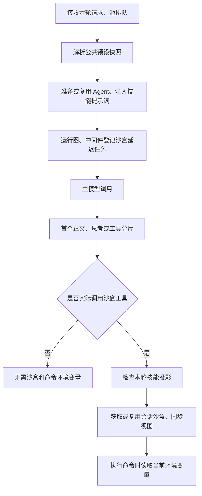

# 首块链路复查与准备阶段优化（2026-11-11）

## 结论与边界

公共预设曾改变沙盒初始化顺序，#77 已修复；当前普通聊天不需要先创建沙盒或同步技能文件，也不读取用于执行命令的环境变量。本次优化继续减少技能元数据处理中的重复工作，没有改变模型、模式、提示词内容、权限边界或沙盒复用策略。

线上 Safari 的 GLM-5.3-Flash、闪速模式抽测中，同一会话第二轮从点击发送到首段正文出现约 **3.44–3.54 秒**。这是 UI 可见时间的一次样本，包含前后端、网络和模型等待，不能据此判断代码故障，也不能用本地微基准推算线上降幅。本次代码尚未部署到线上。

## Git 链与加载顺序

复查基线为 `main` 的 `4d3aee4`。相关节点如下：

| 阶段 | 变化 | 对首块路径的影响 |
| --- | --- | --- |
| 公共预设前，`9dc7872` | 普通聊天原本采用沙盒延迟初始化 | 无白名单、无既有投影视图的普通路径不在模型前获取沙盒；显式白名单路径原本可提前准备 |
| #68，`e5896a3` | 每轮绑定公共预设，沙盒中间件把存在预设视为需要投影 | 即使默认 `lazy_init=True`，也可能在 `before_agent` 准备视图、获取沙盒并同步，进入首块关键路径 |
| #69–#74 | 配置恢复、缓存失效、默认开关、环境管理、临时变量和技能生命周期 | 预设解析开始检查公共目录；环境变量仍在命令执行时读取，不是普通聊天的沙盒启动条件 |
| #77，`97f85c9` | 每轮登记延迟初始化任务 | 模型前只登记任务；首次沙盒工具访问时才落实投影、获取／复用沙盒和同步 |
| #78–#79，最终 `003bd25` | 固定默认预设，新增公共技能自动补写默认开关 | 正常读取路径曾重复扫描公共目录 |
| #80，`0a17d5b` / 合入 `4d3aee4` | 一次调用共用目录快照，增加准备／首块计时 | 正常读取一次扫描；补写默认项时仍在锁内重新检查 |

现在的逻辑顺序：

图展示模型聊天路径；上传附件等宿主显式文件操作有自己的初始化需求。首次工具执行前还可能存在标题生成等步骤，不能将工具开始时间直接当作模型首块时间。

## 本次实现

1. `skills/parser.py` 对完全相同的 frontmatter 文本缓存 YAML 解析结果。每次仍发现目录、检查文件并读取内容，随后重新生成包含当前路径／类别的 `Skill`。缓存不保存用户启用状态，不依赖文件时间戳；同大小、同 mtime 的外部修改仍立即可见。缓存最多 512 项，每项最多 16 Ki 字符，超限和 YAML 异常不缓存。
2. `UserScopedSkillStorage.load_skills()` 在一次发现中只读取一份私有开关文件，替代逐个技能重复读取和 JSON 解析；没有私有技能时不读，下一次调用重新读取。公共预设及私有开关与旧全局开关的交集语义保留，旧文件中的空条目仍按原规则默认启用。
3. 同步与托管异步流增加独立的首模型计时回调，仅在 INFO 日志启用时附加。它复制调用方的回调容器，不改变已有追踪配置；流分片回调直接执行，避免为每个 token 投递执行器任务。

沙盒方面保留现有延迟任务：纯聊天不投影、不获取沙盒、不读取执行环境；每轮第一次工具访问落实该轮快照。复用沙盒也必须检查新预设和文件变更，不能因为容器存在就跳过同步。未改变的本地投影视图不会再次复制；远程同步与篡改检查仍执行。环境变量在每次执行命令时重新合并，复用容器中的后续新命令不会继承上轮临时变量；已启动进程仍保留其启动时的环境。

## 性能测量

本机临时目录内生成 200 个公共和 200 个私有技能，私有状态文件含 200 项。比较 `4d3aee4` 的用户存储实现及无 YAML 缓存解析，与本次实现；分别测量预设解析、绑定预设快照后的完整技能发现，各取 9 次中位数。没有模型、网络或沙盒参与。

| 操作 | 修改前 | 修改后缓存冷态 | 修改后缓存热态中位数 |
| --- | ---: | ---: | ---: |
| 200 个公共技能的预设解析 | 33.73 ms | 32.96 ms | 15.19 ms |
| 200 公共 + 200 私有技能发现 | 76.34 ms | 66.89 ms | 32.07 ms |

冷态为清空 YAML 缓存后单次调用，不能与中位数作为严格统计对照。热态两项分别减少约 55% 和 58%；这是局部准备成本，不能相加视为每一轮的固定收益，因为复用 Agent 时不一定进行完整技能发现。目录很小时绝对收益更小；技能超过缓存容量、元数据频繁改变或存储 I/O 慢时也会限制收益。

## 分段定位方法

按同一 trace 对齐下列日志：

| 日志字段 | 含义 |
| --- | --- |
| `Managed stream first block.pool_wait_ms` | 客户端池等待 |
| `Managed stream prepared.preset_ms` | 本轮预设解析 |
| `Managed stream prepared.preparation_ms` | Agent、状态等准备 |
| `Client first model started.graph_to_model_ms` | 运行图到首次主模型调用，包括图内中间件等准备 |
| `Client first model response.model_to_response_ms` | 模型调用到首次有效模型分片；包含模型适配器，不是纯 HTTP 首字节 |
| `Managed stream first block.elapsed_ms` | 托管调用入口到首个真实内容块入队 |

标题、空文本块和错误回退不充当首 token；非流式模型的完整响应明确记为 `kind=complete`。计时日志不记录提示词、正文或变量值。同步流新增模型阶段计时；现有 `Managed stream` 两类日志只属于托管入口。

Voris 源码还包含图外步骤：进入模型前同步线程文件、查询和保存消息；转发每个事件前查询取消状态、处理元数据，首个思考片段还会先持久化再写 Redis。当前保持其先持久化再转发的恢复语义。它们是否显著拖慢线上首块，需要对应服务的计时和实际部署版本验证，不能从本地源码直接断言。

## 验证与未覆盖范围

- 当前仓库 `tests/` 完整回归执行 580 项（18.9 秒），34 项按环境开关跳过，其余全部通过。包含首模型计时专项 5 项与元数据／私有开关性能回归 7 项。
- 缓存测试覆盖相同文本复用、路径／类别独立、同大小同 mtime 修改、删除、读取权限失败、YAML 诊断、超限不缓存，以及私有开关外部更新。
- 沙盒测试覆盖同步／托管流在新旧会话中首块前零投影、零沙盒获取、零环境读取，以及不重复复制未变化视图。
- 显式运行真实 Docker/AIO 验收，4 项通过（46.9 秒）：同容器 9 轮复用与变量增改删、并发用户和工具隔离、取消／异常／重生成清理、预设快照与下一轮切换。使用确定性测试模型图和独立命名容器，测试容器已清理。
- Safari 第一轮采样存在较大空档，不作为延迟样本。另一个新会话出现消息区空白，刷新后仍空白，未计入延迟统计；本次不能确定其原因。
- 没有本次修改部署后的线上前后对照，也没有线上数据库、Redis、模型服务的独立耗时；不能承诺某个首 token 秒数。
